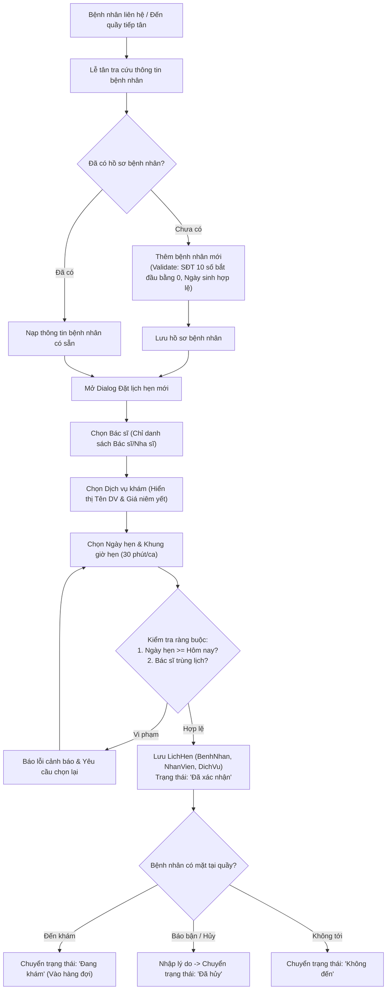
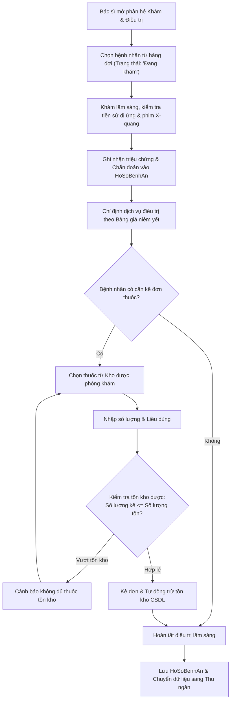
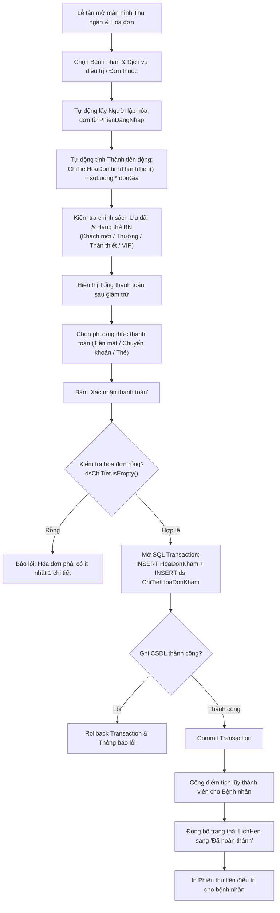
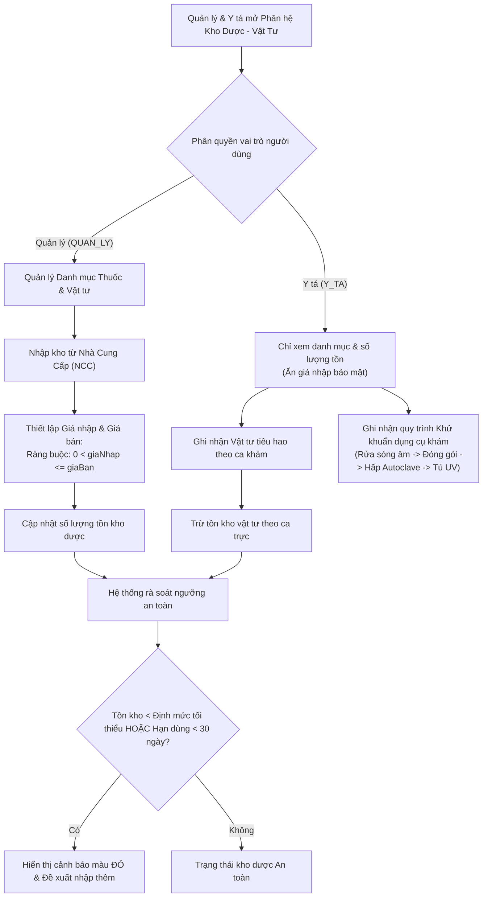
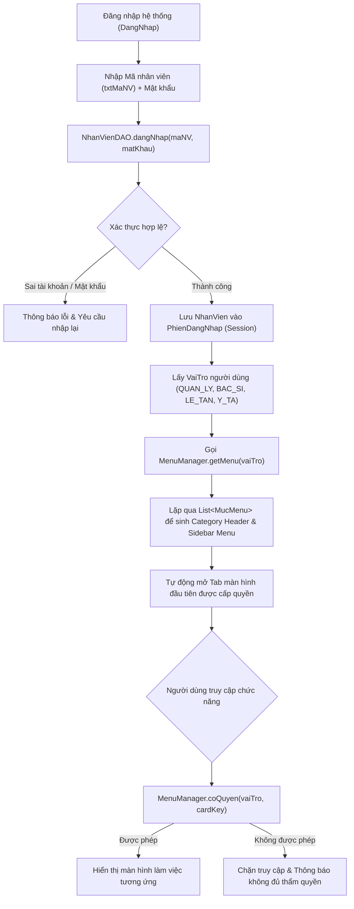

# TÀI LIỆU QUY TRÌNH NGHIỆP VỤ & KIẾN TRÚC HỆ THỐNG
## DỰ ÁN: PHẦN MỀM QUẢN LÝ PHÒNG KHÁM NHA KHOA ABC
**Công nghệ:** Java Swing, JDBC, Microsoft SQL Server  
**Kiến trúc:** Phân lớp Hướng Đối Tượng (Model - View - Controller/Service - DAO)  

---

## MỤC LỤC
1. [PHẦN I: 5 QUY TRÌNH NGHIỆP VỤ CỐT LÕI & SƠ ĐỒ MERMAID](#phần-i-5-quy-trình-nghiệp-vụ-cốt-lõi--sơ-đồ-mermaid)
   - [Quy trình 1: Tiếp đón & Đặt lịch hẹn khám nha khoa](#quy-trình-1-tiếp-đón--đặt-lịch-hẹn-khám-nha-khoa)
   - [Quy trình 2: Khám bệnh & Kế hoạch điều trị nha khoa](#quy-trình-2-khám-bệnh--kế-hoạch-điều-trị-nha-khoa)
   - [Quy trình 3: Thu ngân, Lập hóa đơn & Thanh toán](#quy-trình-3-thu-ngân-lập-hóa-đơn--thanh-toán)
   - [Quy trình 4: Quản lý kho dược phẩm & Vật tư y tế](#quy-trình-4-quản-lý-kho-dược-phẩm--vật-tư-y-tế)
   - [Quy trình 5: Quản trị phân quyền & Cấu hình hệ thống](#quy-trình-5-quản-trị-phân-quyền--cấu-hình-hệ-thống)
2. [PHẦN II: BẢNG CHECKLIST ĐỐI CHIẾU YÊU CẦU GIẢNG VIÊN VỚI MÃ NGUỒN](#phần-ii-bảng-checklist-đối-chiếu-yêu-cầu-giảng-viên-với-mã-nguồn)
3. [PHẦN III: HƯỚNG DẪN CÀI ĐẶT & VẬN HÀNH HỆ THỐNG](#phần-iii-hướng-dẫn-cài-đặt--vận-hành-hệ-thống)

---

# PHẦN I: 5 QUY TRÌNH NGHIỆP VỤ CỐT LÕI & SƠ ĐỒ MERMAID

---

### Quy trình 1: Tiếp đón & Đặt lịch hẹn khám nha khoa

- **Vai trò thực hiện:** Lễ tân (`VaiTro.LE_TAN`).
- **Mục tiêu:** Tiếp nhận yêu cầu khám, quản lý hồ sơ thông tin bệnh nhân, sắp xếp lịch hẹn không trùng giờ của bác sĩ, tiếp đón đưa bệnh nhân vào hàng đợi khám.
- **Điều kiện tiên quyết:** Bệnh nhân liên hệ qua hotline, đặt hẹn online hoặc đến trực tiếp tại quầy tiếp tân.

#### 1. Các bước thực hiện chi tiết
1. **Tra cứu bệnh nhân:**
   - Lễ tân nhập từ khóa tìm kiếm: Nếu nhập mã BN (`BN...`), hệ thống gọi `benhNhanDAO.timTheoMa()`. Nếu nhập số điện thoại hoặc họ tên, hệ thống gọi `benhNhanDAO.timTheoHoTenVaSdt()`.
   - Nếu bệnh nhân đã có hồ sơ: Nạp thông tin hành chính, tiền sử dị ứng và điểm tích lũy thành viên.
   - Nếu là bệnh nhân mới: Lễ tân mở form tạo mới, nhập Họ tên, Ngày sinh (bắt buộc, không lớn hơn ngày hiện tại), Số điện thoại (bắt buộc đúng 10 chữ số, bắt đầu bằng số 0: `^0\d{9}$`), Địa chỉ, Giới tính, Tiền sử bệnh lý. Kiểm tra trùng SĐT qua CSDL trước khi lưu.
2. **Chọn thông tin đặt lịch:**
   - **Bác sĩ phụ trách:** ComboBox CHỈ lọc các nhân viên có vai trò Bác sĩ / Nha sĩ (`nhanVienDAO.getDanhSachBacSi()`), không hiển thị lễ tân, y tá hay quản lý.
   - **Dịch vụ khám:** ComboBox hiển thị rõ `Mã DV - Tên dịch vụ (Đơn giá niêm yết VNĐ)`.
   - **Thời gian hẹn:** Chọn ngày khám qua `DatePickerField` (kiểm tra không được chọn ngày trong quá khứ) và khung giờ khám (chuẩn y khoa 30 phút/khung giờ).
3. **Kiểm tra xung đột lịch:**
   - Hệ thống tự động kiểm tra `lichHenDAO.kiemTraTrungLichBacSi(maBS, ngay, gio, maLH)`. Nếu bác sĩ đã có lịch chưa hủy trong khung giờ đó, hệ thống từ chối lưu và yêu cầu chọn giờ/bác sĩ khác.
4. **Lưu lịch hẹn:**
   - Lịch hẹn được tạo dưới dạng đối tượng liên kết: `LichHen(maLH, benhNhanObj, bacSiObj, dichVuObj, ngay, gio, tenDV, ghiChu, TrangThaiConstants.LH_DA_XAC_NHAN)`.
5. **Tiếp đón vào khám:**
   - Khi bệnh nhân có mặt tại phòng khám, Lễ tân bấm "Chuyển hàng đợi", trạng thái chuyển sang `LH_DANG_KHAM` ("Đang khám").

#### 2. Vòng đời trạng thái đối tượng `LichHen`
`Đã lên lịch` -> `Đã xác nhận` -> `Đang khám` (Hàng đợi phòng khám) -> `Đã hoàn thành` (Sau khi thanh toán) / `Đã hủy` (Bắt buộc nhập lý do hủy) / `Không đến`.

#### 3. Sơ đồ quy trình Mermaid


---

### Quy trình 2: Khám bệnh & Kế hoạch điều trị nha khoa

- **Vai trò thực hiện:** Bác sĩ / Nha sĩ (`VaiTro.BAC_SI`).
- **Mục tiêu:** Tiếp nhận bệnh nhân từ hàng đợi, chẩn đoán bệnh lý, tư vấn giải pháp điều trị và kê đơn thuốc (nếu có).
- **Ràng buộc:** Bác sĩ chỉ xem và cập nhật hồ sơ bệnh án y khoa, không can thiệp sửa thông tin hành chính của bệnh nhân hay bảng giá dịch vụ.

#### 1. Các bước thực hiện chi tiết
1. **Tiếp nhận ca khám:**
   - Bác sĩ mở phân hệ "Khám bệnh & Điều trị", chọn bệnh nhân từ danh sách bệnh nhân đang ở trạng thái `Đang khám` (hàng đợi ca trực).
2. **Khám lâm sàng & Chẩn đoán:**
   - Khám tổng quát răng miệng, kiểm tra hình ảnh cận lâm sàng (X-quang Panorex, CT ConeBeam).
   - Ghi nhận triệu chứng cơ năng, bệnh sử và chẩn đoán xác định vào `HoSoBenhAn`.
3. **Lập kế hoạch điều trị & Chỉ định dịch vụ:**
   - Tư vấn cho bệnh nhân phác đồ điều trị (nhổ răng khôn, trám răng composite, cấy ghép implant, niềng răng...).
   - Chỉ định danh mục dịch vụ nha khoa theo đúng bảng giá niêm yết của phòng khám.
4. **Kê đơn thuốc y khoa:**
   - Bác sĩ chọn thuốc từ danh mục `Thuoc` của phòng khám.
   - Nhập số lượng kê và liều dùng / cách dùng cụ thể.
   - Hệ thống tự động kiểm tra tồn kho (`soLuongTon`): Nếu số lượng kê vượt quá tồn kho thực tế, chặn lại và cảnh báo.
   - Khi bác sĩ xác nhận, hệ thống tự động trừ trực tiếp số lượng tồn kho của thuốc trong CSDL.
5. **Hoàn tất ca điều trị:**
   - Bác sĩ lưu hồ sơ bệnh án, xác nhận hoàn thành công đoạn lâm sàng, dữ liệu tự động chuyển sang phân hệ Thu ngân để làm thủ tục thanh toán.

#### 2. Sơ đồ quy trình Mermaid


---

### Quy trình 3: Thu ngân, Lập hóa đơn & Thanh toán

- **Vai trò thực hiện:** Lễ tân / Thu ngân (`VaiTro.LE_TAN`).
- **Mục tiêu:** Lập hóa đơn minh bạch, áp dụng chính sách giảm giá/ưu đãi tự động, thu tiền và in phiếu thu cho bệnh nhân.
- **Ràng buộc thiết kế:**
  - **Không lưu cột `tongTien`, `thanhTien` trong CSDL và Entity.**
  - `ChiTietHoaDonKham.tinhThanhTien() = soLuong * donGia`.
  - `HoaDonKham.tinhTongTienTruocGiam() = SUM(cthd.tinhThanhTien())`.
  - `HoaDonKham.tinhGiamGia() = tinhTongTienTruocGiam() * phanTramGiam / 100`.
  - `HoaDonKham.tinhTongTien() = tinhTongTienTruocGiam() - tinhGiamGia()`.
  - Hóa đơn bắt buộc phải có ít nhất 1 chi tiết mặt hàng (`dsChiTiet.isEmpty()` sẽ bị chặn ném Exception). Hóa đơn và chi tiết được lưu trong cùng một **Transaction có commit/rollback**.

#### 1. Các bước thực hiện chi tiết
1. **Lập phiếu thanh toán:**
   - Lễ tân chọn Bệnh nhân và Dịch vụ khám / Đơn thuốc. Đơn giá được chốt tại thời điểm bán (lấy từ `DichVu.giaNiemYet` hoặc `Thuoc.giaBan`).
   - Người lập hóa đơn tự động lấy từ phiên đăng nhập hiện tại (`PhienDangNhap.getNhanVien()`).
2. **Áp dụng ưu đãi & Hạng thẻ thành viên:**
   - Hệ thống tự động kiểm tra điểm tích lũy của bệnh nhân để xác định hạng thẻ (`Khách mới`, `Thường`, `Thân thiết`, `VIP`) hoặc áp dụng mã khuyến mãi (`UuDai`).
   - Tự động tính tỷ lệ giảm giá và hiển thị số tiền thanh toán cuối cùng.
3. **Thực hiện thu tiền:**
   - Chọn phương thức thanh toán: Tiền mặt, Chuyển khoản ngân hàng hoặc Thẻ tín dụng/ghi nợ.
   - Bấm "Xác nhận thanh toán": Hệ thống thực hiện Transaction lưu `HoaDonKham` và các dòng `ChiTietHoaDonKham`.
4. **Tích điểm & Đồng bộ trạng thái:**
   - Hệ thống tự động tích điểm thưởng thành viên (mỗi 10,000 VNĐ = 1 điểm tích lũy).
   - Tự động đồng bộ lịch hẹn liên quan của bệnh nhân sang trạng thái `LH_HOAN_THANH` ("Đã hoàn thành").
5. **In phiếu thu:**
   - Hiển thị hộp thoại bản in phiếu thu tiền dịch vụ với định dạng biên nhận chuẩn, thông tin phòng khám, bác sĩ điều trị và tổng tiền.

#### 2. Sơ đồ quy trình Mermaid


---

### Quy trình 4: Quản lý kho dược phẩm & Vật tư y tế

- **Vai trò thực hiện:** Quản lý (`VaiTro.QUAN_LY`) & Y tá / Điều dưỡng (`VaiTro.Y_TA`).
- **Mục tiêu:** Quản lý xuất nhập tồn thuốc và vật tư tiêu hao, kiểm soát hạn dùng, đảm bảo vô trùng khử khuẩn dụng cụ khám.
- **Ràng buộc:**
  - Thuốc có 2 loại giá: `giaNhap` (giá mua từ NCC, chỉ Quản lý được xem/sửa) và `giaBan` (giá bán duy nhất khi kê đơn/lập hóa đơn).
  - Ràng buộc: $0 < \text{giaNhap} \le \text{giaBan}$.
  - Y tá không được xem hoặc chỉnh sửa giá nhập của thuốc/vật tư.

#### 1. Các bước thực hiện chi tiết
1. **Nhập kho dược phẩm (Quản lý):**
   - Quản lý chọn nhà cung cấp (`NCC`), nhập thông tin thuốc, số lô, hạn sử dụng, số lượng nhập, `giaNhap` và thiết lập `giaBan`.
2. **Theo dõi vật tư tiêu hao theo ca trực (Y tá):**
   - Y tá ghi nhận các vật tư tiêu hao phát sinh trong từng ca khám (găng tay y tế, kim tiêm tê, bông gòn, chỉ tự tiêu, cốc súc miệng...).
   - Hệ thống tự động trừ tồn kho vật tư tiêu hao.
3. **Theo dõi chu trình khử khuẩn dụng cụ (Y tá):**
   - Ghi nhận trạng thái khử khuẩn dụng cụ: Ngâm dung dịch khử trùng -> Rửa sóng siêu âm -> Đóng gói túi vô trùng -> Hấp sấy Autoclave -> Lưu trữ tủ tia cực tím UV.
4. **Cảnh báo tồn kho an toàn:**
   - Tự động hiển thị nhãn cảnh báo đỏ đối với các mặt hàng có tồn kho dưới định mức tối thiểu hoặc hạn sử dụng dưới 30 ngày.

#### 2. Sơ đồ quy trình Mermaid


---

### Quy trình 5: Quản trị phân quyền & Cấu hình phòng khám

- **Vai trò thực hiện:** Quản trị viên / Quản lý (`VaiTro.QUAN_LY`).
- **Mục tiêu:** Quản trị danh sách nhân sự, cấp tài khoản, thiết lập phân quyền giao diện hướng đối tượng theo vai trò, cấu hình bảng giá và quy chế phòng khám.

#### 1. Các bước thực hiện chi tiết
1. **Quản lý hồ sơ nhân viên:**
   - Quản lý thêm mới nhân sự với tiền tố mã chuẩn hóa theo vai trò: `QL...` (Quản lý), `BS...` (Bác sĩ/Nha sĩ), `LT...` (Lễ tân), `YT...` (Y tá/Điều dưỡng).
2. **Cấp phát tài khoản đăng nhập:**
   - Tạo tài khoản với Tên đăng nhập trùng `MaNV`, mật khẩu mặc định `123456`, trạng thái `Hoạt động`.
   - Vai trò được liên kết chặt chẽ qua Enum `VaiTro` (`QUAN_LY`, `BAC_SI`, `LE_TAN`, `Y_TA`).
3. **Phân quyền hướng đối tượng qua `MenuManager`:**
   - Hệ thống không sử dụng các câu lệnh `if/else` theo chuỗi vai trò cứng trong giao diện.
   - Form chính `TrangChu` gọi `MenuManager.getMenu(VaiTro)` để nhận danh sách các đối tượng `MucMenu` mà vai trò đó có quyền truy cập (`vaiTroDuocTruyCap.contains(vaiTro)`).
   - Sidebar tự động vẽ các nút chức năng và tự động mở tab chức năng đầu tiên được phép truy cập ngay sau khi đăng nhập.
4. **Cấu hình bảng giá dịch vụ & Quy chế:**
   - Quản lý cập nhật bảng giá niêm yết dịch vụ nha khoa, chính sách chiết khấu thẻ thành viên và nội quy phòng khám.

#### 2. Sơ đồ quy trình Mermaid


---

# PHẦN II: BẢNG CHECKLIST ĐỐI CHIẾU YÊU CẦU GIẢNG VIÊN VỚI MÃ NGUỒN

| STT | Nội dung yêu cầu của Giảng viên | Trạng thái | Tệp mã nguồn đã triển khai | Lớp / Phương thức / Vị trí cụ thể |
| :---: | :--- | :---: | :--- | :--- |
| **1** | **Xoá Dashboard, banner "Trung tâm điều hành", xoá thanh tìm kiếm topbar; tự mở menu đầu tiên** | **HOÀN THÀNH** | [`gui/TrangChu.java`](file:///c:/Users/LOQ/Downloads/PhanMem_PhongKham_NhaKhoa/PhanMem_PhongKham_NhaKhoa/PhanMem_PhongKham_NhaKhoa/src/gui/TrangChu.java) | - Xoá hoàn toàn `pnlDashboard` và các nút tắt.<br>- Xoá thanh tìm kiếm nhanh, giữ đồng hồ và SQL status.<br>- Dòng 252: `switchTab(!menuItems.isEmpty() ? menuItems.get(0).getCardKey() : "BENH_NHAN")`. |
| **2** | **Bỏ chữ "Modern" khỏi toàn bộ tên lớp, đổi tên panel sang `Panel<ChucNang>_<VaiTro>`** | **HOÀN THÀNH** | Toàn bộ package `gui` | - `DangNhap.java` (thay `LoginModern`).<br>- `PanelBenhNhan_DungChung.java`, `PanelLichHen_DungChung.java`, `PanelThanhToan_LeTan.java`, `PanelKhamBenh_BacSi.java`, `PanelTaiKhoan_QuanLy.java`... |
| **3** | **Quan hệ giữa các Entity phải là ĐỐI TƯỢNG, không dùng String mã FK rời rạc** | **HOÀN THÀNH** | Package `entity` | - `LichHen`: `BenhNhan benhNhan`, `NhanVien bacSi`, `DichVu dichVu`.<br>- `HoaDonKham`: `BenhNhan benhNhan`, `NhanVien nhanVien`, `UuDai uuDai`.<br>- `ChiTietHoaDonKham`: `HoaDonKham hoaDon`, `DichVu dichVu`, `Thuoc thuoc`.<br>- `TaiKhoan`: `NhanVien nhanVien`.<br>- `NhanVien`: `VaiTro vaiTro` (Enum). |
| **4** | **KHÔNG lưu tổng tiền/thành tiền trong CSDL và Entity; tính động bằng phương thức** | **HOÀN THÀNH** | [`entity/HoaDonKham.java`](file:///c:/Users/LOQ/Downloads/PhanMem_PhongKham_NhaKhoa/PhanMem_PhongKham_NhaKhoa/PhanMem_PhongKham_NhaKhoa/src/entity/HoaDonKham.java)<br>[`entity/ChiTietHoaDonKham.java`](file:///c:/Users/LOQ/Downloads/PhanMem_PhongKham_NhaKhoa/PhanMem_PhongKham_NhaKhoa/PhanMem_PhongKham_NhaKhoa/src/entity/ChiTietHoaDonKham.java) | - Xoá thuộc tính `tongTien`, `thanhTien`.<br>- `ChiTietHoaDonKham.tinhThanhTien()`: `soLuong * donGia`.<br>- `HoaDonKham.tinhTongTienTruocGiam()`, `tinhGiamGia()`, `tinhTongTien()`. |
| **5** | **HoaDonKham chứa `List<ChiTietHoaDonKham>`, chặn lưu nếu rỗng, lưu trong 1 Transaction** | **HOÀN THÀNH** | [`entity/HoaDonKham.java`](file:///c:/Users/LOQ/Downloads/PhanMem_PhongKham_NhaKhoa/PhanMem_PhongKham_NhaKhoa/PhanMem_PhongKham_NhaKhoa/src/entity/HoaDonKham.java)<br>[`dao/HoaDonDAO.java`](file:///c:/Users/LOQ/Downloads/PhanMem_PhongKham_NhaKhoa/PhanMem_PhongKham_NhaKhoa/PhanMem_PhongKham_NhaKhoa/src/dao/HoaDonDAO.java) | - `HoaDonKham.themChiTiet()`, `xoaChiTiet()`.<br>- `HoaDonDAO.themHoaDon()`: ném `IllegalArgumentException` nếu `dsChiTiet.isEmpty()`.<br>- Quản lý bằng `conn.setAutoCommit(false)`, `conn.commit()`, `conn.rollback()`. |
| **6** | **Xoá thuộc tính `cachDung`, `lieuDung` khỏi ChiTietHoaDon (chỉ thuộc đơn thuốc)** | **HOÀN THÀNH** | [`entity/ChiTietHoaDonKham.java`](file:///c:/Users/LOQ/Downloads/PhanMem_PhongKham_NhaKhoa/PhanMem_PhongKham_NhaKhoa/PhanMem_PhongKham_NhaKhoa/src/entity/ChiTietHoaDonKham.java) | Không chứa `cachDung`, `lieuDung`; chỉ gồm `hoaDon`, `dichVu`, `thuoc`, `soLuong`, `donGia`. |
| **7** | **Làm rõ 2 loại giá thuốc trong `Thuoc`: `giaNhap` và `giaBan`, ràng buộc $0 < \text{giaNhap} \le \text{giaBan}$** | **HOÀN THÀNH** | [`entity/Thuoc.java`](file:///c:/Users/LOQ/Downloads/PhanMem_PhongKham_NhaKhoa/PhanMem_PhongKham_NhaKhoa/PhanMem_PhongKham_NhaKhoa/src/entity/Thuoc.java) | Bổ sung `giaNhap`, `giaBan`, có Javadoc chi tiết; ném ngoại lệ khi vi phạm ràng buộc $0 < \text{giaNhap} \le \text{giaBan}$. |
| **8** | **XOÁ hoàn toàn `ChiTietDieuTri` (Entity, DAO, Bảng CSDL, Menu liên quan)** | **HOÀN THÀNH** | [`Database/update_schema.sql`](file:///c:/Users/LOQ/Downloads/PhanMem_PhongKham_NhaKhoa/PhanMem_PhongKham_NhaKhoa/PhanMem_PhongKham_NhaKhoa/Database/update_schema.sql) | Xóa file entity `ChiTietDieuTri.java`, xoá tham chiếu trong DAO, lệnh `DROP TABLE ChiTietDieuTri`. |
| **9** | **DAO dùng 100% PreparedStatement, JOIN nạp đầy đủ đối tượng liên kết (tránh N+1 query)** | **HOÀN THÀNH** | Package `dao` | `HoaDonDAO`, `LichHenDAO`, `BenhNhanDAO`, `HoSoBenhAnDAO`, `TaiKhoanDAO`... 100% PreparedStatement và LEFT JOIN. |
| **10** | **Đăng nhập bằng Mã NV + Mật khẩu, xoá ComboBox chọn vai trò; lấy vai trò từ CSDL** | **HOÀN THÀNH** | [`gui/DangNhap.java`](file:///c:/Users/LOQ/Downloads/PhanMem_PhongKham_NhaKhoa/PhanMem_PhongKham_NhaKhoa/PhanMem_PhongKham_NhaKhoa/src/gui/DangNhap.java)<br>[`dao/NhanVienDAO.java`](file:///c:/Users/LOQ/Downloads/PhanMem_PhongKham_NhaKhoa/PhanMem_PhongKham_NhaKhoa/PhanMem_PhongKham_NhaKhoa/src/dao/NhanVienDAO.java) | - Xoá bỏ `cboVaiTro`. Đổi nhãn thành "Mã nhân viên" (`txtMaNV`).<br>- `nhanVienDAO.dangNhap(maNV, matKhau)` tự động truy vấn vai trò trong CSDL.<br>- Lưu thông tin vào `PhienDangNhap`. |
| **11** | **Menu hướng đối tượng: Tạo `MucMenu`, `MenuManager`, xoá các khối if/else vai trò hardcode** | **HOÀN THÀNH** | [`gui/MucMenu.java`](file:///c:/Users/LOQ/Downloads/PhanMem_PhongKham_NhaKhoa/PhanMem_PhongKham_NhaKhoa/PhanMem_PhongKham_NhaKhoa/src/gui/MucMenu.java)<br>[`gui/MenuManager.java`](file:///c:/Users/LOQ/Downloads/PhanMem_PhongKham_NhaKhoa/PhanMem_PhongKham_NhaKhoa/PhanMem_PhongKham_NhaKhoa/src/gui/MenuManager.java)<br>[`gui/TrangChu.java`](file:///c:/Users/LOQ/Downloads/PhanMem_PhongKham_NhaKhoa/PhanMem_PhongKham_NhaKhoa/PhanMem_PhongKham_NhaKhoa/src/gui/TrangChu.java) | `TrangChu.buildRoleBasedMenu()` duyệt qua `MenuManager.getMenu(vaiTro)` để sinh menu động; kiểm tra quyền qua `MenuManager.coQuyen()`. |
| **12** | **Nghiệp vụ Lễ tân: Validate SĐT 10 số bắt đầu bằng 0, chặn ngày quá khứ, chặn trùng giờ BS** | **HOÀN THÀNH** | [`gui/PanelBenhNhan_DungChung.java`](file:///c:/Users/LOQ/Downloads/PhanMem_PhongKham_NhaKhoa/PhanMem_PhongKham_NhaKhoa/PhanMem_PhongKham_NhaKhoa/src/gui/PanelBenhNhan_DungChung.java)<br>[`gui/PanelLichHen_DungChung.java`](file:///c:/Users/LOQ/Downloads/PhanMem_PhongKham_NhaKhoa/PhanMem_PhongKham_NhaKhoa/PhanMem_PhongKham_NhaKhoa/src/gui/PanelLichHen_DungChung.java) | - Regex SĐT `^0\d{9}$`.<br>- Bắt buộc ngày sinh không vượt quá ngày hiện tại.<br>- `xuLyDoiGioHen()` chặn ngày quá khứ & kiểm tra `kiemTraTrungLichBacSi()`.<br>- Disable các nút phân công ca nhân sự khi là Lễ tân. |
| **13** | **Luồng Đặt lịch: ComboBox Bác sĩ (chỉ BS), ComboBox Dịch vụ (tên + giá), lưu đối tượng** | **HOÀN THÀNH** | [`gui/PanelLichHen_DungChung.java`](file:///c:/Users/LOQ/Downloads/PhanMem_PhongKham_NhaKhoa/PhanMem_PhongKham_NhaKhoa/PhanMem_PhongKham_NhaKhoa/src/gui/PanelLichHen_DungChung.java)<br>[`gui/PanelBenhNhan_DungChung.java`](file:///c:/Users/LOQ/Downloads/PhanMem_PhongKham_NhaKhoa/PhanMem_PhongKham_NhaKhoa/PhanMem_PhongKham_NhaKhoa/src/gui/PanelBenhNhan_DungChung.java) | Bổ sung nút & Dialog đặt lịch ở cả 2 màn hình; ComboBox Bác sĩ lọc đúng `BAC_SI`, ComboBox Dịch vụ hiển thị kèm giá niêm yết; truyền đối tượng liên kết đầy đủ. |
| **14** | **Chuẩn hoá 2 cách tìm kiếm bệnh nhân thống nhất trong toàn bộ hệ thống** | **HOÀN THÀNH** | [`dao/BenhNhanDAO.java`](file:///c:/Users/LOQ/Downloads/PhanMem_PhongKham_NhaKhoa/PhanMem_PhongKham_NhaKhoa/PhanMem_PhongKham_NhaKhoa/src/dao/BenhNhanDAO.java) | Viết chuẩn 2 phương thức:<br>1. `timTheoMa(String maBN) -> BenhNhan`.<br>2. `timTheoHoTenVaSdt(String hoTen, String sdt) -> List<BenhNhan>`. Áp dụng đồng bộ tại các form GUI. |

---

# PHẦN III: HƯỚNG DẪN CÀI ĐẶT & VẬN HÀNH HỆ THỐNG

### 1. Thứ tự thực thi SQL Script
Để hệ thống khởi chạy với cấu trúc CSDL chuẩn hóa nhất, thực thi 2 script trong thư mục `Database/` theo thứ tự:
1. **Bước 1: Chạy file `Database/QLPHONGKHAM.sql`**
   - Khởi tạo toàn bộ cơ sở dữ liệu `QLPHONGKHAM`, các bảng dữ liệu gốc và nạp dữ liệu mẫu ban đầu.
2. **Bước 2: Chạy file `Database/update_schema.sql`**
   - Tự động sao lưu dữ liệu an toàn vào các bảng `..._Backup`.
   - Xóa bỏ bảng thừa `ChiTietDieuTri`.
   - Xóa bỏ các cột tính toán tổng tiền `tongTien`, `thanhTien`, xóa `cachDung`, `lieuDung` trong bảng hóa đơn.
   - Thêm cột `giaNhap`, `giaBan`, `maNCC` cho bảng `Thuoc`.
   - Tạo bảng chuẩn hóa `ChiTietHoaDonKham`.
   - Thêm cột khóa ngoại `maDichVu` vào bảng `LichHen`.

### 2. Danh sách tài khoản đăng nhập mẫu theo từng vai trò

| Mã nhân viên (Tên đăng nhập) | Mật khẩu | Họ và tên | Chức danh / Vai trò | Quyền hạn giao diện |
| :---: | :---: | :--- | :---: | :--- |
| **`QL001`** | `123456` | Trần Thị Hoàng Lan | **Quản lý (`QUAN_LY`)** | **Toàn quyền:** Báo cáo doanh thu & Thống kê, Bác sĩ & Nhân sự, Tài khoản, Cài đặt quy chế, Quản lý kho dược phẩm & Thiết lập giá nhập/bán thuốc, Nghiệp vụ khám & Thu ngân. |
| **`BS001`** | `123456` | BS. CKII Nguyễn Văn An | **Bác sĩ / Nha sĩ (`BAC_SI`)** | **Khám chữa bệnh:** Hồ sơ bệnh nhân, Phân hệ Khám & Chẩn đoán lâm sàng, Kế hoạch điều trị, Kê đơn trừ tồn kho, Xem lịch trực & Bảng giá dịch vụ. (Ẩn nhân sự, tài khoản, thu ngân). |
| **`LT001`** | `123456` | Phạm Thu Thảo | **Lễ tân (`LE_TAN`)** | **Tiếp đón & Thu ngân:** Tiếp đón bệnh nhân, Đặt / Đổi / Hủy lịch hẹn, Xem lịch bác sĩ, Thu ngân lập hóa đơn & Thanh toán, Áp dụng ưu đãi, In phiếu thu, Thống kê doanh thu cuối ngày. (Ẩn quản lý nhân sự, kho dược). |
| **`YT001`** | `123456` | Đỗ Mai Anh | **Y tá / Điều dưỡng (`Y_TA`)** | **Hỗ trợ & Vô trùng:** Ghi nhận vật tư tiêu hao theo ca, Theo dõi quy trình khử khuẩn dụng cụ Autoclave/UV, Xem lịch trực, Thống kê cuối ngày. (Ẩn giá nhập, bảng giá, thu ngân). |

### 3. Lệnh biên dịch & Khởi chạy ứng dụng bằng dòng lệnh (CLI)
Mở cửa sổ dòng lệnh tại thư mục gốc của dự án (`PhanMem_PhongKham_NhaKhoa`):

- **Biên dịch toàn bộ dự án:**
  ```powershell
  # Tạo danh sách các file mã nguồn
  [System.IO.File]::WriteAllLines('sources.txt', (Get-ChildItem -Path 'src' -Recurse -Filter '*.java' | Select-Object -ExpandProperty FullName), [System.Text.Encoding]::ASCII)
  
  # Biên dịch bằng javac
  javac -encoding UTF-8 -cp "lib/*;src" -d bin @sources.txt
  ```

- **Khởi chạy ứng dụng:**
  ```powershell
  java -cp "bin;lib/*" gui.DangNhap
  ```

